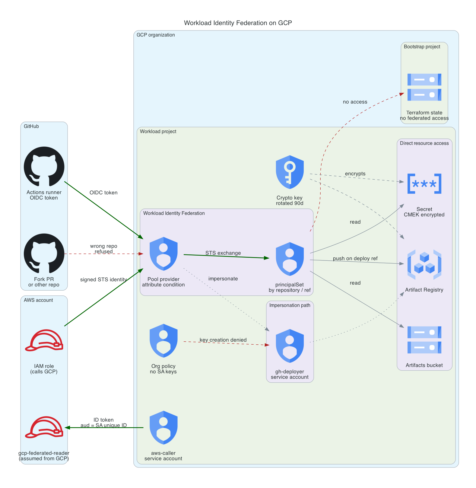

# GCP Workload Identity Federation

CI that authenticates to Google Cloud with no service account key, anywhere, and an org policy that makes creating one impossible even for a project owner.

Four federation paths are built side by side so the trade-offs between them are visible rather than asserted: GitHub Actions to GCP with direct resource access, the same thing with service account impersonation, AWS to GCP, and GCP to AWS.



Green paths are allowed, red ones are refused. A GitHub token from this
repository exchanges for short-lived access; a fork or any other repository is
refused by the provider's attribute condition. AWS calls in through the same
pool, and GCP calls out to AWS with an ID token. Nothing federated can reach the
bootstrap project that holds state, and the org policy denies service account
key creation to everyone, owners included.

**Cost:** under $0.25 per month if left standing. **Teardown:** roughly five minutes, with three GCP-specific gotchas documented at the bottom.

## The security problem

A service account key is a JSON file containing a private key that does not expire. It authenticates as its service account from anywhere on the internet, forever, until someone notices and revokes it. Leaked keys are found in public repositories within minutes and are a routine root cause of cloud incidents.

The usual mitigations are procedural: do not commit keys, rotate them, scan for them. Every one of them depends on nobody making a mistake.

Workload identity federation removes the key. GitHub signs a short-lived OIDC token asserting which repository and which ref is running. Google's Security Token Service validates that token against a pool provider and returns an access token that expires in an hour. Nothing durable exists to leak.

The interesting part is not the exchange. It is what constrains it, because a federation pool configured without constraints is worse than a key: it trusts every token its issuer signs, and GitHub's issuer signs a token for every workflow run in every repository on GitHub.

## Architecture

Two projects under one folder.

**Bootstrap project.** Terraform state and its access logs. No federated identity has any access here. The split matters because state describes the shape of everything else, and CI never needs to read it.

**Workload project.** Everything a federated identity can reach: the pools and providers, an artifacts bucket, an Artifact Registry repository, a CMEK-encrypted secret, and the one service account that exists only so the impersonation path can be compared against the direct path.

The folder is deliberately thin. It is the smallest scaffold this build needs, shaped so a landing zone can adopt it later rather than requiring a parallel hierarchy to be stood up alongside it.

### The four paths

**Path 1, GitHub to GCP with direct resource access.** The federated principal holds IAM roles on resources directly. No service account is involved at any point. Bindings use a `principalSet://` member that matches on a mapped attribute:

- `attribute.repository` matching the repository grants read on the bucket and the secret
- `attribute.ref` matching `refs/heads/main` grants object create and registry push

Splitting authority across two attributes of the same pool is what makes a pull request from a fork able to read but not write.

**Path 2, GitHub to GCP with impersonation.** The same token, exchanged for a service account through `roles/iam.workloadIdentityUser`. Built alongside path 1 for comparison, not because this build needs it.

Use direct access by default. Reach for impersonation when you need an identity that outlives the CI run, when a Google API will not accept a federated principal, or when a resource type has no IAM policy of its own. It costs you a service account that exists whether or not a workflow is running.

**Path 3, AWS to GCP.** A second pool with an `aws` provider type. GCP verifies the caller by validating a signed `GetCallerIdentity` request against AWS STS, which is why this provider takes an account ID rather than an issuer URL. The assumed-role ARN carries a per-call session name, so the attribute mapping reconstructs the stable role name to bind against.

**Path 4, GCP to AWS.** The reverse leg. AWS treats `accounts.google.com` as a built-in web identity provider, so no OIDC provider resource is created on the AWS side. Trust is pinned to the service account's numeric unique ID rather than its email, because an email is reusable after deletion and a unique ID is not.

## Controls, and why each one is there

**The attribute condition is the control.** Attribute mapping renames claims. It does not decide who gets in. The provider pins both the repository and its owner, so a token from any other repository is refused at the pool before any IAM binding is evaluated. Deny at the door, then scope inside it.

**Write access is bound to a ref, not a repository.** Without this, any pull request, including one from a fork, runs with the same authority as a merge to main.

**Org policy makes the key story enforceable.** `iam.disableServiceAccountKeyCreation` and `iam.disableServiceAccountKeyUpload` are applied to the workload project. With both enforced, no one can create or upload a key in this project, including a project owner and including you. This is the difference between "we do not use keys" and "keys cannot exist here."

**CMEK on the secret and the registry.** Not protection against Google. It is a revocation control: disabling one key version makes every secret version and every image layer under it unreadable at once, with no IAM edit and nothing deleted.

**No default VPC in either project.** The default network ships with permissive firewall rules, including SSH and RDP from anywhere, that nobody chose and few audit.

**Data access audit logs on both projects.** Admin activity logging is always on and free. Data access logs are what actually answer "who read this secret," which is the question this project exists to make answerable.

## What the first apply broke

Four failures, each fixed in code rather than worked around:

1. **`organizationAdmin` cannot create a folder.** It administers IAM policy on
   the organization; it does not include `resourcemanager.folders.create`. The
   deployer needs `folderAdmin` as well.
2. **`organizationAdmin` cannot set org policy either.** The two key
   constraints need `orgpolicy.policyAdmin`.
3. **User credentials billed API calls to a project nobody owns.** Application
   default credentials from `gcloud auth` have no quota project, so `orgpolicy`
   and `serviceusage` calls went to Google's shared OAuth client project and
   failed with `SERVICE_DISABLED` on an unfamiliar project ID. Both providers
   now set `billing_project` and `user_project_override`.
4. **The Secret Manager service agent did not exist yet.** The KMS grant
   referenced it before Google had created it. That one is propagation lag and
   resolves on retry.

The first two are the useful lesson: the role that sounds like it owns the
organization is an IAM role, not a hierarchy or policy role.

## Deploy

Requires an existing GCP organization and an open billing account, plus four org-level roles. Three of them are not obvious, and each one was discovered by an apply failing:

| Role | Needed for | Note |
|---|---|---|
| `resourcemanager.projectCreator` | Creating both projects | |
| `billing.user` | Linking billing | |
| `resourcemanager.folderAdmin` | Creating and deleting the folder | `organizationAdmin` does **not** include `folders.create`. It administers IAM policy, it does not create hierarchy |
| `orgpolicy.policyAdmin` | The two key constraints | Also not part of `organizationAdmin` |

**If you apply with user credentials** from `gcloud auth application-default login`, set a quota project first:

```bash
gcloud auth application-default set-quota-project <workload-project-id>
```

User ADC has no quota project by default, so APIs that require one, `orgpolicy` and `serviceusage` among them, bill the call to Google's shared OAuth client project and fail with `SERVICE_DISABLED` on a project ID you have never seen. The provider blocks set `billing_project` and `user_project_override` to handle this, but the quota project still has to exist on the credential.

```bash
# 1. Bootstrap. Local state, because this layer creates the state bucket.
cd bootstrap
cp terraform.tfvars.example terraform.tfvars   # set org_id and billing_account
terraform init
terraform apply

# 2. Wire the root module to the bucket the bootstrap layer just created.
cd ../terraform
terraform -chdir=../bootstrap output -raw backend_hcl > backend.hcl
terraform -chdir=../bootstrap output -raw tfvars_snippet > terraform.tfvars

# 3. Federation, secrets, and org policy.
terraform init -backend-config=backend.hcl
terraform apply
```

To include the cross-cloud legs, set `enable_aws_leg = true` and have AWS credentials in the environment. The GitHub paths work without it.

## Validation

Five checks. The last two are the ones worth running, because they prove a control by failing.

Checks 4 and 5 below were run against live infrastructure on 2026-08-10 and are reproduced in the deploy record at the end of this file. Checks 1 through 3 require the repository to be on GitHub, since they need GitHub's OIDC issuer to mint a token.

**1. Federation works with no key.** Run the `WIF demo` workflow, passing the Terraform outputs as inputs. `gcloud auth list` in the job prints a `principal://` identity rather than a service account.

**2. The secret is readable through the federated principal.** The same job reads the CMEK-encrypted secret with no service account in the path.

**3. Impersonation still works.** The second job authenticates with `service_account` set and `gcloud auth list` now prints the service account, which is the visible difference between the two paths.

**4. Write is refused off the deploy ref.** On any branch other than `main`, the job attempts an object write and expects it to fail. If it succeeds, the workflow fails deliberately, because the ref-scoped binding has stopped holding.

**5. A key cannot be created.** This is the org policy proof:

```bash
gcloud iam service-accounts keys create /tmp/should-not-exist.json \
  --iam-account="gh-deployer@${PROJECT_ID}.iam.gserviceaccount.com"
```

Expect `FAILED_PRECONDITION`, with `constraints/iam.disableServiceAccountKeyCreation` named in the violation. Run it as an owner. It still fails, which is the point.

Note that gcloud creates the output file before it calls the API, so the path exists afterwards as a 0-byte file. That is a client artifact, not a key. Check the size, not the presence.

## Anti-pattern, and why the condition matters

The failure mode this build is shaped against is a pool provider created with no `attribute_condition`. It looks harmless and it is catastrophic:

```hcl
# Do not do this.
resource "google_iam_workload_identity_pool_provider" "unsafe" {
  attribute_mapping = { "google.subject" = "assertion.sub" }
  oidc { issuer_uri = "https://token.actions.githubusercontent.com" }
  # No attribute_condition. Every GitHub repository on earth is now a valid
  # token source for this pool.
}
```

The IAM bindings would still limit what an intruder could do, so this is not instantly fatal. But it inverts the model: it makes every binding in the project the only thing standing between a stranger's workflow and your resources, and it takes one over-broad binding added a year later to finish the job.

## Security scan results

CI runs the shared gates from [platform-guardrails](https://github.com/jordann6/platform-guardrails): gitleaks, `terraform fmt` and `validate`, a provider lock file assertion, tflint, Checkov, Trivy config, and an OPA policy suite. Every gate blocks on failure. None are report-only.

Current state: `terraform/` 25 passed, 0 failed, 3 documented waivers. `bootstrap/` 12 passed, 0 failed, 1 documented waiver.

| Finding | Risk it represents | Resolution |
|---|---|---|
| CKV_GCP_27, default network exists | Default VPC carries firewall rules allowing SSH and RDP from anywhere | Fixed. `auto_create_network = false` on both projects |
| CKV2_GCP_5, audit logging not configured | No record of who read a secret or read state | Fixed. Data access audit logs on all services in both projects |
| CKV_GCP_84, registry not encrypted with a customer key | No single revocation lever across stored artifacts | Fixed. Registry uses the same CMEK key as Secret Manager |
| CKV_GCP_62, bucket does not log access | Federated access leaves no independent record | Fixed. Artifacts and state buckets log to dedicated log buckets |
| CKV_GCP_82, KMS key not protected from deletion | A destroyed key is unrecoverable | Waived. This is a deploy-demo-destroy build with a documented teardown, and the guard would strand every teardown after the first. In production this check should hold |
| CKV_GCP_125, OIDC trust policy | Over-permissive federation trust | Waived. The check requires an equality test on `assertion.sub`. This provider pins repository and owner instead, which is Google's documented pattern and is what allows read and write to be split by ref. Pinning `sub` would collapse both into one identity |
| CKV_GCP_62 on the log buckets | Access logging not enabled on the log bucket itself | Waived. Logging has to terminate somewhere. Self-logging trips CKV_GCP_63, and another hop only relocates the question |

## What changes at production scale

This is a portfolio build. The gap between it and a production implementation is worth naming.

**The org policies belong at a folder, not a project.** Project-level constraints protect one project and are trivially bypassed by creating a second one. In production these attach to a folder or the org, with exceptions granted deliberately.

**One repository does not scale as a trust boundary.** With dozens of repositories, the condition becomes a topic-based or org-wide condition plus per-repository principal sets, and provider creation moves into a module so nobody hand-writes a condition and omits it.

**Ref pinning is not enough on its own.** A ref-scoped binding is defeated by anyone who can push to `main`. Production pairs it with branch protection and required reviews, so the ref means what the binding assumes it means.

**Secret Manager here holds one placeholder.** Real usage needs rotation, and rotation needs a consumer that tolerates a version changing underneath it. That is a larger design problem than the storage.

**No detection.** Everything here is preventive. A production version alerts on federation from an unexpected repository, on org policy changes, and on key creation attempts, which are all in the audit logs this project turns on but nothing currently reads.

**Break-glass is unaddressed.** Removing key creation entirely is correct until the day federation is broken and a human needs in. Production needs a documented, alerted, time-boxed exception path.

## Teardown

```bash
cd terraform && terraform destroy
cd ../bootstrap && terraform destroy   # set force_destroy_state = true first
```

Three GCP behaviors to expect:

**A deleted workload identity pool is soft-deleted for 30 days and its ID cannot be reused in that window.** Rebuilding sooner means bumping `pool_suffix`, which is why that variable exists.

**A KMS key ring cannot be deleted, ever.** Destroy removes it from state and leaves the ring in the project. Key versions are scheduled for destruction rather than deleted. An empty key ring costs nothing.

**Deleted projects are recoverable for 30 days and their IDs are never reusable.** They stay visible in `gcloud projects list` in `DELETE_REQUESTED` state for that window, which looks like a failed teardown and is not one. Confirm the state and the billing link rather than the absence of the row. Project IDs here carry a random suffix so a rebuild does not collide.

**The KMS key ring survives a normal destroy, but not a project deletion.** Destroying only the root module leaves an empty key ring behind, costing nothing. Destroying the bootstrap layer takes the whole project with it, key ring included.

After destroy, confirm nothing is left:

```bash
gcloud projects describe <project-id> --format="value(lifecycleState)"   # DELETE_REQUESTED
gcloud billing projects describe <project-id> --format="value(billingEnabled)"  # False
gcloud resource-manager folders list --organization="${ORG_ID}"          # empty
```

## Deploy record

Built, deployed, validated, and destroyed on 2026-08-10 against organization `jordandn13-org`.

| Step | Result |
|---|---|
| Bootstrap apply | 19 resources. Folder, two projects, state bucket, log bucket, audit configs |
| Federation apply | 22 resources. Pool, provider, bindings, CMEK chain, two org policies |
| Attribute condition live | Pinned to owner and repository, confirmed on the deployed provider |
| Org policies live | Both constraints returned `enforce = True` |
| Default networks | Zero in both projects |
| Secret encryption | Secret bound to the customer-managed key, confirmed via API |
| Key creation as owner | Refused, `constraints/iam.disableServiceAccountKeyCreation` |
| Teardown | 22 then 20 resources destroyed. Folder gone, buckets gone, both projects `DELETE_REQUESTED` with billing unlinked |
| Cost | Under $0.05 for the full cycle |

The four failures from the first apply are in [What the first apply broke](#what-the-first-apply-broke).
